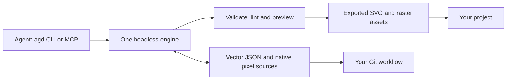

<div align="center">

# Agent Graphic Design

### Graphics your agents can create, inspect, edit and ship.

[](https://github.com/pevyhlas/agentgraphicdesign/actions/workflows/ci.yml)
[](LICENSE)
[](#status)

[Quickstart](#quickstart) · [Capabilities](#capabilities) · [MCP setup](#mcp-setup) · [Reference](REFERENCE.md) · [Contributing](CONTRIBUTING.md)

</div>

Agent Graphic Design (**AGD**) is a headless .NET graphics engine with an **`agd` CLI** and an
**`agd-mcp` MCP server**. Author deterministic vector documents and layered pixel stills,
inspect bounded results, preview cheaply, and export assets your project can keep in Git.
Both tools use one shared engine; no GUI, cloud account or database is required.

> **Experimental public preview.** Only **.NET 10 on Linux x64** is qualified. The public
> source is ahead of the former 0.3.0 release; **no release bundle is available in this public
> repository yet**. Build from source. Formats and APIs may change between 0.x minor releases.

## Capabilities

| Available in source | What it does |
|---|---|
| Vector authoring | Shapes, paths, text, groups and frames in deterministic `.agd.json` documents. |
| Layout and edits | Atomic patches, bounds, alignment, distribution, text layout and path operations. |
| Export and previews | SVG, PNG, JPEG and WebP; bounded previews, contact sheets and advisory design lint. |
| Native still pixels | Layered RGBA8 assets, masks, region edits, PNG import, preview and export. |
| Design systems | Color and typography tokens, palettes and DTCG import/export. |
| Asset pipelines | Manifest-driven builds, drift checks and bounded supplied-PNG verification. |

**Not yet:** sprite animation, tile authoring, the full raster editor, complete artifact
admission/preservation, a human GUI, or hosted/multi-user editing. CLI and MCP share semantics
but not every convenience command; see the [tested surface matrix](docs/CLI_MCP_PARITY.md).
Verification does not establish rights, provenance approval or admission.

For 3D modeling, materials, lighting and renders, use the separate companion
[AgentBlender](https://github.com/pevyhlas/agentblender); AGD never runs or bundles Blender.

## Quickstart

### Requirements

Install **.NET SDK 10.0.113**, the exact version in `global.json`. For a user-local SDK,
keep `DOTNET_ROOT` and `PATH` configured in your shell and MCP client; see the
[SDK installation instructions](REFERENCE.md#requirements).

```sh
git clone https://github.com/pevyhlas/agentgraphicdesign.git
cd agentgraphicdesign
dotnet restore FTPlus.AgentGraphicDesign.slnx --locked-mode
dotnet build FTPlus.AgentGraphicDesign.slnx --configuration Release --no-restore
./scripts/install-local.sh       # installs agd and agd-mcp as global .NET tools

agd create my-design
agd add my-design.agd.json rectangle --width 100 --height 60 --fill "#336699"
agd validate my-design.agd.json
agd export my-design.agd.json --type svg --output output.svg
```

Add `~/.dotnet/tools` to `PATH` if needed. `./scripts/uninstall-local.sh` removes the tools.
Release installation, once a public bundle exists, uses [checksums and source pins](docs/installation.md),
not an unqualified package from a public feed.

## MCP setup

Create a working directory for your designs, then give your MCP client a stdio entry:

```json
{
  "mcpServers": {
    "agd": {
      "command": "agd-mcp",
      "args": ["--working-directory", "/absolute/path/to/designs"]
    }
  }
}
```

With a user-local .NET installation, set the entry's `env.DOTNET_ROOT` and use an absolute
`command` path if the client cannot find `agd-mcp`. See [complete client setup](REFERENCE.md#mcp-server).
Discover `get_capabilities`, then read `agd://agent-guide`, `agd://format` and `agd://schema`.
MCP file access is confined to the chosen directory; the CLI has ordinary local-user access.

## How it works



AGD does not operate Git for you. Keep authoritative sources, settings and required artwork;
exclude rebuildable caches. The tools run locally and emit **no product telemetry**.

## Documentation

| I want to… | Read |
|---|---|
| Author with an agent | [Agent guide](docs/agent-guide.md) |
| Look up commands, fonts or MCP tools | [Usage reference](REFERENCE.md) |
| Understand the vector format | [Format reference](docs/format.md) · [JSON schema](schemas/agd-document.schema.json) |
| Build a repeatable asset set | [Asset pipeline](docs/asset-pipeline.md) |
| Work on layered pixels or import a still | [Native pixel contract](docs/contracts/native-pixels-v1.md) · [Still import](docs/native-still-import.md) |
| Check supplied artifacts | [Provided artifacts](docs/provided-artifacts.md) |
| Review or restore project changes | [Git workflow](docs/git-workflow.md) |
| See release blockers and CI | [Public readiness](docs/public-readiness.md) |
| Understand the product | [Product](specs/product.md) · [Architecture](specs/architecture.md) |

## Status

One maintainer, a handful of projects, a tested subset of the full-editor direction.
macOS and Windows are not qualified authoring profiles. Some vector operations run there;
guarded pixel and asset workflows can fail closed. Read the [platform limits](REFERENCE.md#status)
before relying on another OS. Source builds report `0.3.0+<commit>`; include the full version
in bug reports. The [changelog](CHANGELOG.md) distinguishes source changes from releases.

## Contributing and license

GitHub Actions runs tests, coverage, package smoke, dependency/security, formatting and
readiness gates on **GitHub-hosted runners**. Fork PRs receive no secrets; actions are
SHA-pinned and workflow permissions are read-only. See [CONTRIBUTING.md](CONTRIBUTING.md),
[SECURITY.md](SECURITY.md) and the [code of conduct](CODE_OF_CONDUCT.md).
[Product-Kit](https://github.com/pevyhlas/product-kit) **1.1.1** is vendored; no submodule is
needed to clone or build.

AGD is [MIT licensed](LICENSE). Dependencies and the bundled Inter fonts keep their own
[licenses and notices](THIRD-PARTY-NOTICES.txt), including the
[SkiaSharp native notices](THIRD-PARTY-NOTICES-SKIASHARP.txt).
