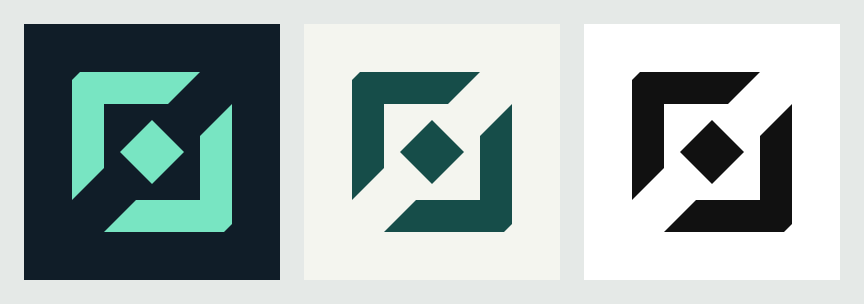

# AGD identity proposal



Original geometric artwork, authored with AGD's CLI. The opposing brackets frame an editable
center; the flat mark pairs with AgentBlender's separately rendered sculptural emblem.
This is a proposal for owner selection.

- [Dark PNG](generated/agd-dark.png) · [Light PNG](generated/agd-light.png) · [Mono PNG](generated/agd-mono.png)
- [Dark SVG](generated/agd-dark.svg) · [Light SVG](generated/agd-light.svg) · [Mono SVG](generated/agd-mono.svg)
- Editable `.agd.json` sources are alongside each export. [Design philosophy](philosophy.md).

## Reproduce

From this directory, with the current source build of AGD:

```sh
agd validate generated/agd-dark.agd.json --strict
agd export generated/agd-dark.agd.json --strict -o generated/agd-dark.svg
agd export generated/agd-dark.agd.json --strict --no-system-fonts -t png --scale 4 -o generated/agd-dark.png
```

`bash create.sh` reauthors all three variants; newly added nodes get fresh identifiers.
To reproduce exact exports, use the committed sources above instead. No system fonts are used.
The dark mark was also inspected at 32 px; all variants pass strict validation.

## Provenance

Created here from original path geometry, with no external artwork, fonts or dependencies added.
Project MIT terms apply. Authoring/export tool: source build
`0.3.0+4c08bd3f6fe0685fbe306ca5755a94d12a7e75d8`, .NET 10.0.113, Linux x64.
The contact sheet uses AGD's existing compositor; no image-editing script produced these pixels.

Dark PNG SHA-256: `6d198cbf3acb58f8cf1067108d864002a3c73761bc0ed6c3646f5b1aa0ee5ca1`.
