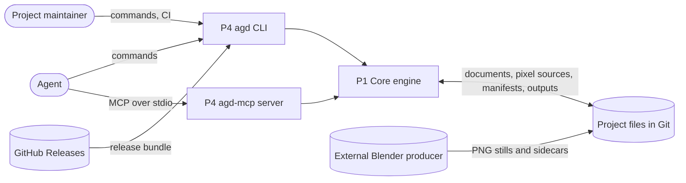
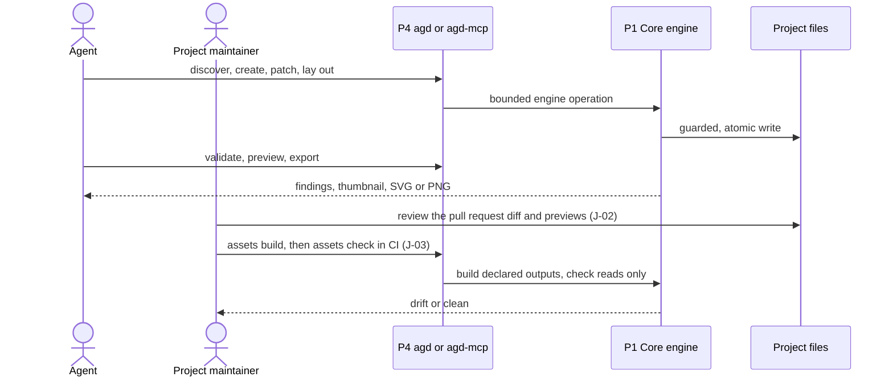

# Agent Graphic Design — architecture

**Inherits**: none

A headless .NET 10 engine library runs in process inside two thin tools, a CLI and an MCP stdio
server, over ordinary project files: no network listener, database, GUI or hosted service.

## Shape

Project state is the user's own files (C-06): vector documents, native pixel source
directories, asset manifests and outputs, versioned in Git by the user. P4 parses and bounds
arguments and maps results; P1 owns every validation, write and evaluation. Trust boundary:
file contents and MCP arguments are untrusted and bounded; the local filesystem is trusted and
quiescent during an operation; the MCP server is confined to one working directory, the CLI is
not.

## Parts

| Part | What it is | Why it exists | Components | Maturity | Spec |
|------|------------|---------------|------------|----------|------|
| P1 Core engine | .NET library, in process in both tools; every authoritative operation | J-01 to J-08; R-01 to R-13 | vector documents, rendering and export, import, paths and tokens, asset pipeline, native pixels, provided artifacts, planned domains | validated | [p1-core-engine](parts/p1-core-engine.md) |
| P4 CLI and MCP server | the `agd` CLI and the `agd-mcp` stdio server, shipped as two .NET tool packages | J-01, J-03 to J-05, planned J-06 to J-08; R-01, R-03 | CLI, MCP server | validated | [p4-cli-mcp-server](parts/p4-cli-mcp-server.md) |

## Core loop

## Key decisions

- **Custom JSON scene graph in one engine** (D-12): one Core library owns the vector format;
  CLI and MCP never implement edits of their own (C-04).
- **Git-first files, no database** (D-08): versioned project files; no selection store, receipt
  ledger or required Git.
- **Native pixels owned by AGD** (D-04, D-19): versioned fixed-point evaluation defines
  composites, never a codec or library; PNG input is decoded by AGD's own bounded decoder;
  pixel, sprite and tile semantics never live in vector nodes.
- **Local tools first** (D-02): HTTP, multi-user and hosted modes are later, self-hostable,
  feature-equal modes; no live collaboration.
- **Blender outside AGD** (D-09): a separate producer runs Blender; AGD only verifies and imports
  its exports.
- **Permissive dependencies by exact approval** (D-01).

All decisions: [decisions](architecture/decisions.md). Moved and retired IDs:
[retired](architecture/retired.md).

## Key areas

| Area | In a line | Detail |
|------|-----------|--------|
| Security and privacy | untrusted inputs bounded; MCP confined to its working directory; no secrets, accounts or personal data | [security](architecture/security.md) |
| Observability and live site | none: local tools with no telemetry; failures are structured results and exit codes | this line |
| Data | user-owned project files; previews, locks and caches are rebuildable local data | [data](architecture/data.md) |
| Interfaces | formats, commands and tools with declared promises; GitHub Releases, MCP clients, Git and the Blender producer outside | [interfaces](architecture/interfaces.md) |
| Environments | LOCAL (installed tools) and CI (GitHub-hosted qualification) | [environments](architecture/environments.md) |
| Operations | CI gates, release bundle, package smoke, dependency and notice checks | [operations](architecture/operations.md) |

## Risks

- File safety is claimed only where it is qualified; P1 storage relies on a quiescent local
  filesystem and on Linux primitives. D-28's S0 registry refuses guarded operations except
  on .NET 10 Linux x64 and unqualified Windows x64 .NET 10 pipeline/artifact paths. All native
  pixel operations now refuse on Windows, including reads. Vector/raster remain unguarded,
  unqualified off Linux x64; no macOS backend or qualification is implied (P1.I-09).
- Agents may still need more calls than a person would; the bet is checked through real use
  ([why it works](architecture/why-it-works.md)).

## Left open

- Where previews, renders and caches are kept, as long as none holds sole project intent (D-08).
- An auto-layout engine binding, chosen under D-01 when auto-layout is built.
- How P1 splits into assemblies beyond Core and Skia, as long as Core keeps no host, CLI or MCP
  framework dependency.
