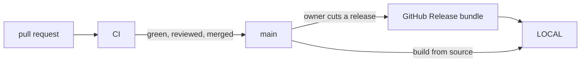

# Agent Graphic Design — environments

<!-- Where the product runs. Each stage names its environment in product/lifecycle.md. -->

| Environment | For | Provisioned in | Data | Who reaches it | A release gets there |
|-------------|-----|----------------|------|----------------|----------------------|
| LOCAL | the product: `agd` and `agd-mcp` installed as .NET global tools on a user's machine or CI runner | the user's own machine or runner; no account or hosted service | the user's real project files | the user and the agents they run | the user installs a release bundle by checksum, or builds from source |
| CI | qualifying every change before merge | GitHub-hosted `ubuntu-24.04` runners of this repository | fixtures and generated test files only | contributors, through pull requests | each pull request (forks included, read-only token, no secrets), each push to `main`, a weekly schedule and manual dispatch |

- **Qualified profile**: .NET 10 Linux x64; the tools are portable framework-dependent global
  tools, and [Q-05](../product/qualities.md) states what runs elsewhere. Apple silicon macOS is
  planned (change 008).
- **macOS CI**: an informational job runs only on the schedule or manual dispatch and never gates
  a merge until macOS is qualified.
- **Isolation**: CI holds no secrets and no user data; LOCAL never sends data anywhere.
- **Data between environments**: never moves; CI uses fixtures only.
