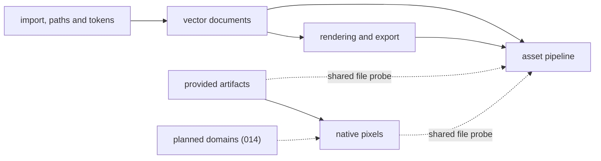

# P1 Core engine

**What it is**: the .NET 10 library that both tools load in process; it holds every authoritative
operation · **Maturity**: validated · **Code**: `src/FTPlus.AgentGraphicDesign.Core/`,
`src/FTPlus.AgentGraphicDesign.Skia/`

## Why it exists

Every journey's work happens here, so the CLI and the MCP server stay thin (R-01, C-04): vector
authoring and export (J-01, R-02, R-08), reviewable byte-stable sources (J-02, R-04, Q-01), the
asset pipeline (J-03, R-05), native pixels and provided-artifact checks (J-04, R-06, R-07), safe
writes (Q-04), bounded work (Q-03) and honest results (Q-02). The planned domains (J-06 to J-08,
R-09 to R-12) join here as their own components over shared foundations.

## Components

- [Vector documents](p1-core-engine/vector-documents.md): the document model, canonical
  serialization, validation, lint, layout, patching and the local store (P1.B-01 to P1.B-08,
  P1.I-01 to P1.I-03).
- [Rendering and export](p1-core-engine/rendering-export.md): SVG export, Skia raster rendering,
  deterministic fonts, symbols, sprite sheets, sub-node export and contact sheets.
- [Import, paths and tokens](p1-core-engine/import-paths-tokens.md): best-effort SVG import,
  Clipper2 path operations, tokens, palettes and DTCG interchange.
- [Asset pipeline](p1-core-engine/asset-pipeline.md): manifest build and check, output
  ownership, drift checks and typed in-process producers.
- [Native pixels](p1-core-engine/native-pixels.md): layered RGBA8 still sources, guarded edits,
  evaluation, PNG export and check, and still import (P1.B-09 to P1.B-14, P1.I-04 to P1.I-08).
- [Provided artifacts](p1-core-engine/provided-artifacts.md): descriptor metadata v1, preflight
  and managed decoded verification.
- [Planned domains](p1-core-engine/planned-domains.md): animation and sprites, tiles, artifact
  admission and raster artwork (hypothesis, planned: 014-full-editor-domains).

Solid edges carry data: vector documents and their rendering feed the asset pipeline, and
still import reads provided artifacts into native pixels. Dotted edges labelled "shared file
probe" are a call dependency only: native pixels and provided-artifact preflight open files
through the asset pipeline's platform probe (P1.I-09). Native pixel sources are not asset
manifest inputs; that integration is still open in the asset pipeline component. The unlabelled
dotted edge is planned work.

## Interface guarantees

- `IDocumentEngine` and the Core services: an in-repository API with no standalone package; a
  breaking change updates every caller in the same change (direct cutover, C-09). Schema:
  `src/FTPlus.AgentGraphicDesign.Core/IDocumentEngine.cs`.
- Formats and contracts: [interfaces](../architecture/interfaces.md).
- Core has no ASP.NET, HTTP, database, MCP or CLI framework dependency; Skia rendering lives in
  the separate Skia assembly.

## Failure semantics

- Errors are structured codes and messages, with absolute host paths reduced to file names
  (`ErrorSanitizer`). A failed mutation leaves stored sources and their revisions unchanged; a
  busy guard rejects at once and never queues.

## Budgets

- Every agent-facing operation has fixed published limits (document, patch, render, decode,
  native and producer budgets); raising one is a reviewed change because it widens Q-03.

## Left open

- Internal service boundaries between components, as long as every surface reaches them through
  `IDocumentEngine` and the shared Core services.
- Each component lists its own.
