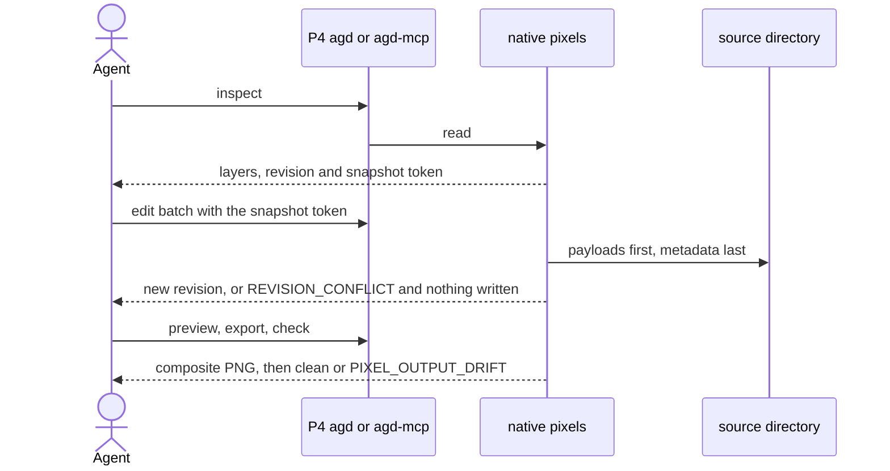

# P1 Core engine — native pixels

**Serves**: J-04; R-06, Q-01, Q-03, Q-04, Q-05 · **Code**: `src/FTPlus.AgentGraphicDesign.Core/Pixels/` (`NativePixelService`), CLI `pixels`, MCP pixel tools · Part: [P1 Core engine](../p1-core-engine.md)

This component is the authority. Exact byte layouts, arithmetic tables, error matrices and
acceptance matrices it does not restate are referenced detail in the normative v1 contracts:
[storage](../../../docs/contracts/native-pixels-v1.md),
[evaluation](../../../docs/contracts/native-pixel-evaluation-v1.md),
[API](../../../docs/contracts/native-pixel-api-v1.md) and
[still import](../../../docs/contracts/native-still-import-v1.md). Where this file and a
contract differ, this file wins and the difference is a defect to fix here.

## What it does

- Holds flat RGBA8 layered stills as AGD-owned native sources, separate from vector nodes
  (C-09), with layer visibility, opacity and editable A8 coverage masks.
- Defines composite results by its own versioned evaluation, not by a codec or library (Q-01).
- Persists every accepted edit immediately and safely under a required snapshot guard (Q-04).
- Imports one provided PNG still exactly through the managed decoder (D-19), keeping the
  original input and its interpretation.

The path of [J-04](../../product/journeys/j-04-edit-pixel-art.md) through it:

## Behaviors

- **P1.B-09 Guarded edits**: every edit requires the caller's snapshot token (asset id,
  revision and source digest); any mismatch is `REVISION_CONFLICT`. Omission is never
  last-writer-wins. Test: `NativePixelEditTests`.
- **P1.B-10 Whole-batch edits**: a batch resolves its operations in order against private
  state, checks every intermediate state and budget, and either publishes once with one
  revision increment or writes nothing. Test: `NativePixelEditTests`.
- **P1.B-11 Byte-exact no-op**: an edit whose final canonical source equals the starting source
  returns `changed=false`, keeps the revision and publishes nothing. Test: `NativePixelEditTests`.
- **P1.B-12 Read-only evaluation**: inspect, region read, validate, preview, export and check
  never write the source; check never writes or repairs an output and reports drift as a
  completed result (`PIXEL_OUTPUT_DRIFT`). Test: `NativePixelOutputTests`, `PixelsCommandTests`.
- **P1.B-13 Exact still import**: an imported PNG becomes a new asset or a new topmost,
  visible, opacity-1, unmasked full-canvas layer of a same-size asset with fresh ids; no
  resampling, trimming, quantization or premultiplication; the original bytes and mapping are
  retained. Results always report `admitted=false` and `provenanceVerified=false`. Test:
  `NativeStillImportTests`, MCP `ProtocolTests` (`StillImportProtocolTests.cs`).
- **P1.B-14 One native operation per host**: a second concurrent native operation is rejected
  immediately with `PIXEL_BUSY`, never queued. Test: `NativePixelServiceTests`, `NativeStillImportTests`.

## Invariants

- **P1.I-04 Old or new, never partial**: payloads are immutable, content-addressed and written
  before metadata, which is published last; readers always see a complete old or new asset.
  Old payloads are never garbage-collected implicitly. Enforced by: `NativePixelStorageTests`.
- **P1.I-05 Versioned arithmetic**: the composite of a given source under evaluation v1 never
  changes; new arithmetic gets a new evaluation id with its own fixtures. Enforced by:
  `NativePixelRendererTests` (literal sample vectors).
- **P1.I-06 Fail closed on unknown or damaged sources**: unknown versions, malformed metadata
  and missing or corrupt payloads are errors; nothing initializes, migrates, downloads or
  repairs them. Enforced by: `NativePixelFormatTests`, `NativePixelStorageTests`.
- **P1.I-07 Outputs never alias sources**: preview and export refuse destinations inside an
  involved asset, its staging or lock paths, or captured inputs, including hard-link and alias
  cases, and do not replace existing files by default. Enforced by: `NativePixelOutputTests`.
- **P1.I-08 Qualified profile only**: storage is qualified only on .NET 10 Linux x64 with a
  trusted, quiescent local filesystem (Q-05); unqualified profiles fail closed (C-11). Every
  read, create and edit passes the shared asset file probe, so another OS, architecture or
  runtime fails closed with `ASSET_PLATFORM_UNSUPPORTED`, except for the Windows pass-through
  stated in P1.I-09. Enforced by: `AssetPipelineTests` (shared probe); CI runs only the
  qualified profile.

## Interface guarantees

- Native source format v1 (`asset.agd-pixels.json` plus `payloads/`): closed metadata with
  canonical bytes; any incompatible change is a new version. Schema: `NativePixelFormat`.
- Snapshot tokens compare state; they are not monotonic epochs, receipts or idempotency keys.
  A Git restore of the exact same state can make an old token valid again.

## Failure semantics

- Cancellation before publication leaves the old asset authoritative. Once publication is
  known to have succeeded, success is reported even if cleanup fails. A genuinely ambiguous
  outcome returns `PIXEL_WRITE_OUTCOME_UNKNOWN`; callers inspect and reconcile, never blindly
  retry.

## Budgets

- Canvas axes, area, layer count, logical source bytes, edit operations, replacement input and
  working reservation are fixed published limits (`NativePixelFormat`, `NativeOperationScope`);
  any canvas size within them is allowed.

## Left open

- Garbage collection of unreferenced payloads, as an explicit operation only (P1.I-04).
