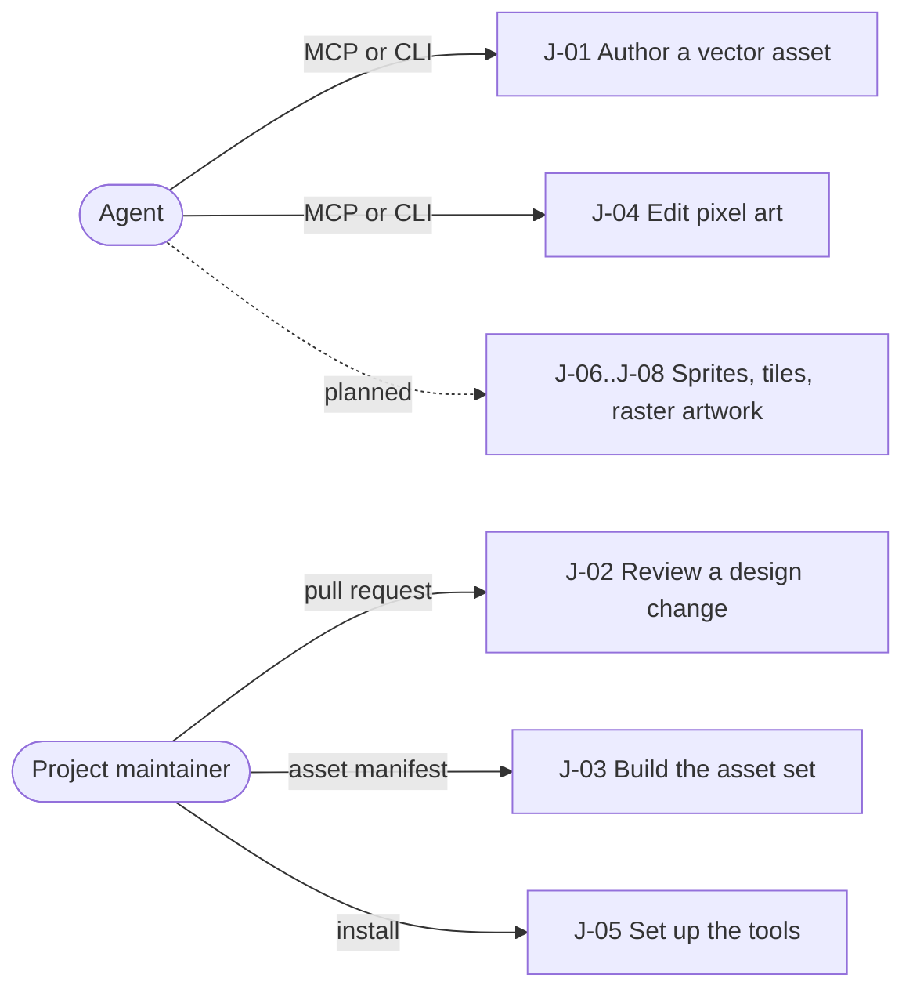

# Agent Graphic Design

A headless graphics editor that AI agents drive over MCP and the command line, so a project's
graphics are authored, checked and exported as reviewable files instead of bespoke scripts.

**Stage**: Public preview · next: GA ([lifecycle](product/lifecycle.md))

## Problem

Agents write code well but have no editor of their own: graphics work falls back to raw SVG,
per-pixel scripts and a hand-made export and check pipeline in every project.

| Pain today | Evidence | Solved by |
|------------|----------|-----------|
| GUI editors assume a person at a screen; an agent cannot drive them | owner direction | J-01, J-04 |
| Raw SVG and ad hoc scripts take one call per edit, pixel or frame | observed in consumer projects | J-01, J-04 |
| Design changes reach review as noisy diffs that hide what changed | owner direction | J-02 |
| Each project rebuilds its own export, sprite-sheet and drift-check scripts | observed: consumer projects carried such pipelines | J-03 |
| Getting the tools running for an agent costs hours | observed in consumer projects | J-05 |
| Animated sprites, tile sets and raster artwork have no agent-native editor | owner direction | J-06, J-07, J-08 |

## Who it is for

| Persona | Wants | Situation | Uses |
|---------|-------|-----------|------|
| Agent | to finish a project's graphics task in a few bounded calls, with results it can check | runs headless in a repository, in a coding session or CI; no screen, limited context | MCP server, CLI |
| Project maintainer | the project's graphics reviewable, reproducible and wired into its build | a developer or solo designer who owns the assets and reviews agent changes in pull requests | CLI, Git diffs, previews |

Not personas: contributors who test AGD (the constitution's review policy) and whoever
packages or self-hosts it (C-02 and the operations topic).

## Journeys

**Core loop**, the journeys the bet depends on:
[J-01 Author a vector asset](product/journeys/j-01-author-vector-asset.md) →
[J-02 Review a design change](product/journeys/j-02-review-design-change.md) →
[J-03 Build the asset set](product/journeys/j-03-build-asset-set.md)

| Area | Public preview (now) |
|------|----------------------|
| Authoring | [J-01 Author a vector asset](product/journeys/j-01-author-vector-asset.md), [J-04 Edit pixel art](product/journeys/j-04-edit-pixel-art.md); planned: [J-06 Animate a sprite](product/journeys/j-06-animate-sprite.md), [J-07 Author a tile set](product/journeys/j-07-author-tile-set.md), [J-08 Edit raster artwork](product/journeys/j-08-edit-raster-artwork.md) |
| Review and delivery | [J-02 Review a design change](product/journeys/j-02-review-design-change.md), [J-03 Build the asset set](product/journeys/j-03-build-asset-set.md) |
| Setup | [J-05 Set up the tools](product/journeys/j-05-set-up-tools.md) |

## What must be true

- One engine behind every surface; CLI and MCP are thin adapters (R-01, C-04).
- Bounded semantic operations, never per-pixel or per-frame call loops (R-03, Q-03).
- Byte-stable output (Q-01), and honest fidelity: loss is reported, never silent (Q-02).
- Sources are ordinary versioned files whose edits diff cleanly; users own Git (R-04, C-06).
- A stale writer that names its expected revision gets a conflict (native pixel edits always
  must), and a failed write leaves no partial file (Q-04).
- Permissive licensing, self-host always, .NET-first with no Python (C-01, C-02, C-03).
- File safety is claimed only where it is qualified, and the gaps are stated (Q-05).

Everything else: [requirements](product/requirements.md), [qualities](product/qualities.md),
[constraints](product/constraints.md), [non-goals](product/non-goals.md). All of them bind every
change; `bounds.sh` lists those in its scope.

## The bet

Agents produce better, reviewable graphics by driving a deterministic, domain-aware engine
through bounded semantic operations than by scripting markup or pixels. Wrong if adopters still
need their own export, check or Python code, or agents need far more calls than a person would.

## Waiting on the owner

- Confirm this restructured spec, and the Public preview stage and its promise ([inbox](inbox.md)).
- Decide how in-flight work from the pre-public history lands here ([inbox](inbox.md)).
- Settle the status of D-09, D-10 and D-11, and the unguarded platform paths of Q-05 ([inbox](inbox.md)).
