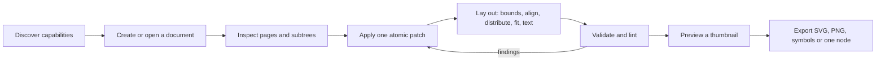

# J-01 Author a vector asset (validated)

**Who**: Agent · **Area**: Authoring · **Surfaces**: MCP server, CLI

## Intent

Produce a correct, exported vector asset (an icon, a card layout, a lockup) for its project
without a GUI, and know it is right before handing it over.

## Situation

The agent works headless inside a repository, in a coding session or a CI job. Its context
window is limited, so it cannot read a large document whole or loop over every element. Some
hosts give it only the command line.

## Scenario

1. It asks what this build can do and sees the version, limits and enabled domains.
2. It creates a document from a template, or opens one and inspects it page by page.
3. It applies a batch of edits as one patch, then aligns, distributes and fits the result and
   lays out wrapped text, with colours and type from design tokens.
4. It validates and lints, and gets structured findings it can act on.
5. It previews a small thumbnail, then exports SVG or PNG, a symbol sprite sheet, or a single
   node cropped to its own bounds.

## Variations

- **Another writer changed the document**: with an expected revision, the patch is refused
  with a revision conflict and nothing is written; the agent re-reads and retries.
- **One edit in a patch is invalid**: the whole patch is refused, naming the failing edit.
- **A limit is reached**: a structured limit error, never unbounded work.
- **Importing an SVG with unsupported features**: the import succeeds with structured warnings
  for what was lost.
- **A document from a newer format**: validation warns and edits are refused.
- **A font is missing**: a substitution diagnostic, or a failure in strict font mode.
- **A path outside the MCP working directory**: refused.

## Success

A valid document and its export in a few bounded calls; for example a three-card layout with
wrapped text, aligned through helpers, in five MCP calls with zero lint findings. For the
project: agents use AGD instead of writing SVG or scripts by hand.
