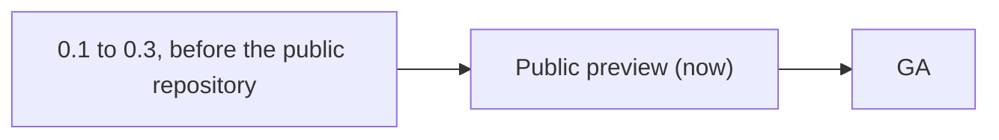

# Agent Graphic Design — lifecycle

**Now**: Public preview since the first public source release · **Next**: GA

<!-- Stages, in order: Idea, Demo, MVP, Private preview, Public preview, GA, Sunset, Retired; skip
those the product does not need. Only the owner moves Now, when the exit criteria pass. An item
needed only from a later stage carries `from: <stage>` with its maturity; without one it is
needed now. Remove a marker once its stage is reached. Each stage's Environment names one from
architecture/environments.md. Past the budget, a stage moves to lifecycle/<stage>.md; Now, Next
and one line and a link per stage stay here. -->

## Public preview (now)

- **Goal**: let anyone run AGD from public source and 0.x releases, and learn whether agents
  author, review and build graphics with it without bespoke scripts (the bet in
  [product.md](../product.md)).
- **Audience**: anyone; agents and project maintainers in their own projects.
- **Environment**: LOCAL, the tools installed on a user's machine or CI runner; real project
  files.
- **Promise**: experimental, and interfaces may change: commands, tools, the native pixel
  format and engine APIs can change between 0.x minor versions as declared cutovers in the
  changelog (C-09); vector format 1 stays additive. Q-01 to Q-06 are enforced on the qualified
  .NET 10 Linux x64 profile; other platforms are unqualified (Q-05). Support is best effort
  through issues.
- **Exit when** (proposed; the owner confirms the stage and these criteria in the inbox):
  agents complete the core loop in real projects without bespoke export or check scripts; the
  supported platforms and the command, tool and format surfaces are stable enough to promise
  compatibility; the owner decides.

## GA

- **Goal**: a supported 1.0 that projects can depend on.
- **Audience**: anyone.
- **Environment**: LOCAL.
- **Promise**: supported; Q-01 to Q-06 enforced on every qualified platform; breaking changes
  to commands, tools and formats need a new major version and a migration path (C-09 is
  revisited when a format leaves 0.x).
- **Exit when**: the owner announces a sunset.
